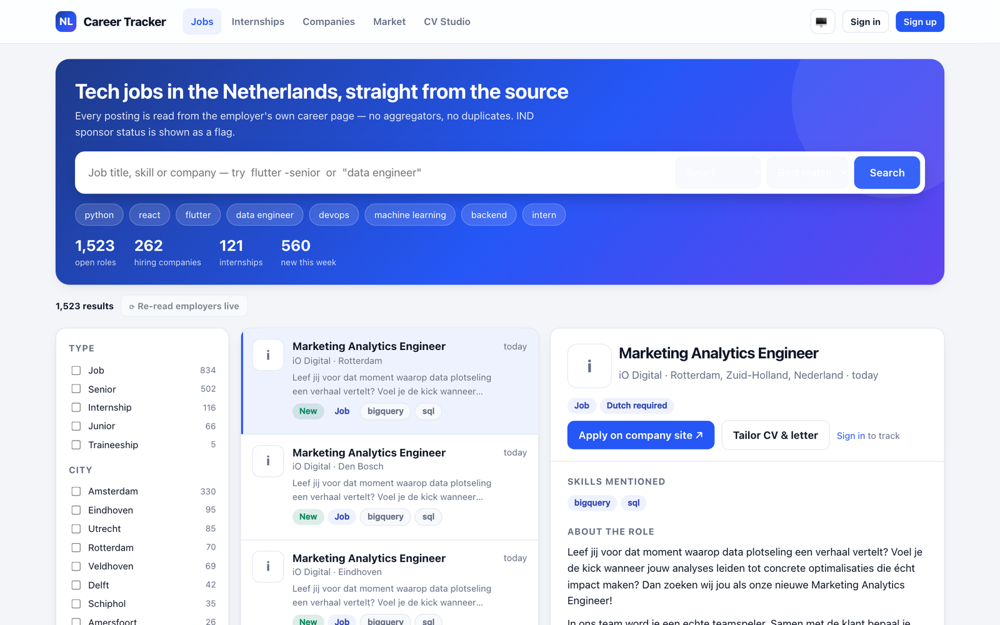
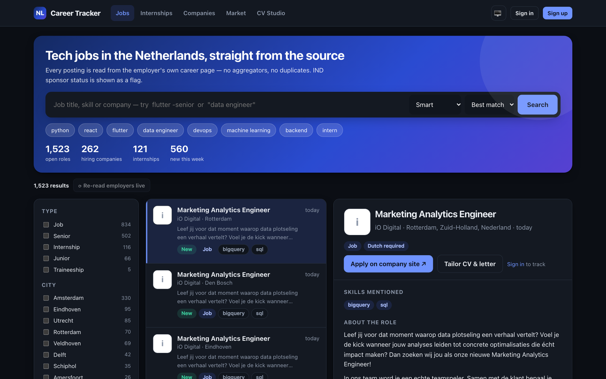
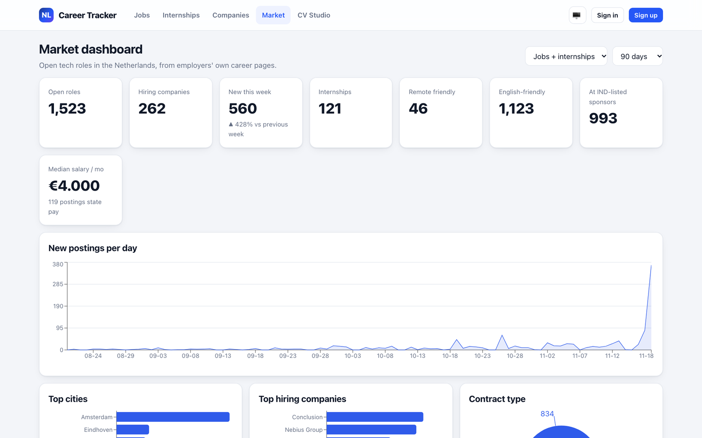
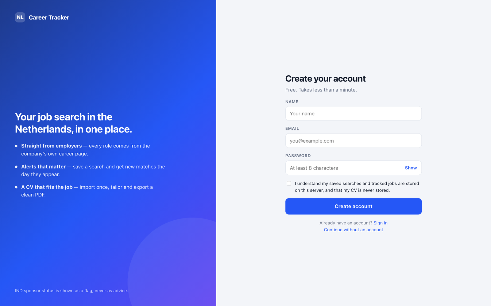
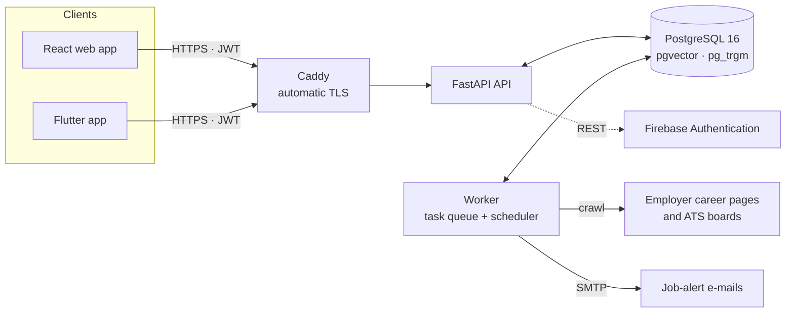

<div align="center">

# 🇳🇱 NL Career Tracker

### Tech jobs & internships in the Netherlands — read straight from the employers' own career pages.

*No aggregators. No duplicates. No stale listings. IND-sponsor status shown as a flag, never as a filter.*

<br>


**[Screenshots](#-see-it)** · **[Features](#-what-it-does)** · **[Architecture](#-architecture)** · **[Tech stack](#-tech-stack)** · **[Achievements](#-what-this-project-achieves)** · **[Run it](#-quick-start)** · **[Deploy it](#-deploy-it-for-free)**

📱 The Flutter app lives in its own repo: **[nl-career-tracker-mobile](https://github.com/emelian-chkaira/nl-career-tracker-mobile)**

</div>

---

## ✨ See it

<p align="center">
  
</p>

<table>
  <tr>
    <td width="50%"><br><sub><b>Dark mode</b> — follows your system, or switch it yourself</sub></td>
    <td width="50%"><br><sub><b>Market dashboard</b> — postings per day, cities, contract types, skills</sub></td>
  </tr>
  <tr>
    <td width="50%"><br><sub><b>Internships &amp; traineeships</b> — crawled and classified separately</sub></td>
    <td width="50%"><br><sub><b>Companies</b> — every employer with its IND sponsor badge</sub></td>
  </tr>
  <tr>
    <td width="50%"><br><sub><b>CV Studio</b> — import, fix, tailor, export a clean LaTeX PDF (sample CV)</sub></td>
    <td width="50%"><br><sub><b>Sign in / sign up</b> — e-mail or Google, password strength meter</sub></td>
  </tr>
</table>

<p align="center"><br><sub>The web app is fully responsive.</sub></p>

> The numbers in the screenshots (1,523 open roles · 262 hiring companies · 121 internships) are a snapshot of the author's development database on 18 Nov 2026.

---

## 🎯 Why it exists

Job boards copy each other. The same vacancy shows up five times, weeks after it was filled, with the wrong salary and a broken apply link.
**NL Career Tracker goes to the source:** it discovers Dutch tech employers, finds their real career pages and ATS boards, reads the postings itself and keeps them fresh.
Then it adds what a job seeker in the Netherlands actually needs: **is this company an IND-recognised sponsor? is the salary above the highly-skilled-migrant threshold? is the role English-friendly?** — and a CV tool that tailors your CV to each posting.

## 🚀 What it does

| | |
|---|---|
| 🔎 **Search that understands you** | Full-text (ranked, highlighted), **semantic** (pgvector + a local embedding model) and **hybrid** (reciprocal-rank fusion). Operators: `"exact phrase"`, `-exclude`, `title:` `company:` `location:` `skill:`. Typo tolerance, synonyms ("flutter" also finds Android/iOS roles), facets and filters for city, type, language, remote, sponsor, salary and date. Sort by best match, newest, salary or **my fit**. |
| 🏢 **Employer-direct crawler** | Public ATS APIs → career-page crawl (+ sitemap) → schema.org JSON-LD → headless Chromium. NL-only, de-duplicated, with vanished postings marked expired and dead ends backed off exponentially. |
| 🎓 **Internships & traineeships** | Student and early-career pages are crawled and **classified** (internship / junior / senior / traineeship) so they get their own tab. |
| 🛂 **IND sponsor + salary check** | Each employer is matched against the IND list of recognised sponsors; stated salaries are compared with the IND thresholds. It is a **badge**, never a filter. |
| 🔔 **Job alerts** | Save any search → instant / daily / weekly. The worker creates in-app notifications and (optionally) e-mails. |
| 📊 **Market dashboard** | Open roles, hiring companies, new postings per day, top cities and companies, contract types, 30-day skill-demand trend, salary statistics. |
| 📄 **CV Studio** | Import **PDF, DOCX, text or LaTeX**. The PDF reader keeps hyperlinks, columns and bold titles; you fix what the parser got wrong; tailor the CV to a job; export a **LaTeX PDF** in the same look as your original; draft a cover letter. Optional opt-in **AI tailoring** with Claude. Nothing is stored on the server. |
| 👤 **Accounts** | Sign up / sign in with e-mail or **Google** (Firebase Authentication), e-mail verification, password reset, per-user pipeline (saved → applied → interview → offer) with notes. |
| 🌗 **Light & dark** | A proper design system on both themes, web and mobile. |

---

## 🏗 Architecture



```
backend/   FastAPI · SQLAlchemy 2 · Alembic · Postgres 16
  app/core        config (CAREERS_* env), db, security, deps, rate limiting
  app/models      ORM tables              app/schemas   request / response models
  app/services    business logic: auth, firebase, search, jobs, analytics, alerts, ingest, embeddings, task queue
  app/api/v1      thin routers: auth, jobs, companies, me, analytics, cv, admin, tasks
  app/crawler     discovery + ATS adapters + scoring (sponsor, salary, language, seniority)
  app/cvtools     PDF layout reader, CV parser, LaTeX generator / compiler, AI tailoring
  app/workers     separate process: DB-backed task queue (FOR UPDATE SKIP LOCKED) + scheduler
  migrations/     Alembic             tests/   pytest against a real Postgres
frontend/  React 18 · TypeScript · Vite — feature folders: auth, jobs, companies, dashboard, alerts, pipeline, cv, profile, admin
deploy/    production compose pieces: Caddyfile, server setup, update and backup scripts
docs/      FIREBASE.md · DEPLOY_ORACLE.md · screenshots
```

The API is stateless and the worker coordinates through Postgres, so both scale horizontally. The in-process rate limiter is per instance — put a gateway or Redis limiter in front when running several API replicas.

## 🧰 Tech stack

| Layer | Technology | Used for |
|---|---|---|
| **API** | Python 3.13, **FastAPI**, Pydantic v2, SQLAlchemy 2, Alembic | Typed REST API, migrations |
| **Database** | **PostgreSQL 16** + **pgvector** + **pg_trgm** | Relational data, full-text search, vector search, typo tolerance |
| **Search** | `tsvector`, `fastembed` (BAAI/bge-small-en-v1.5, local ONNX), reciprocal-rank fusion | Keyword, semantic and hybrid search |
| **Crawling** | `httpx`, BeautifulSoup + lxml, **Playwright** (Chromium) | ATS APIs, career pages, JS-rendered sites |
| **CV tools** | `pdfminer.six`, `pypdf`, **LaTeX** (tectonic), Anthropic API (opt-in) | Layout-aware PDF reading, LaTeX output, AI tailoring |
| **Auth** | **Firebase Authentication** (REST), JWT, **argon2id**, rotating refresh tokens | E-mail + Google sign-in, sessions |
| **Web** | **React 18**, **TypeScript**, Vite, TanStack Query, Recharts | The web app and dashboards |
| **Mobile** | Flutter, Cubit — see [the mobile repo](https://github.com/emelian-chkaira/nl-career-tracker-mobile) | iOS and Android app |
| **Infra** | **Docker** (multi-stage), Docker Compose, **Caddy** (auto-HTTPS), GitHub Actions | Production stack, CI |
| **Quality** | pytest on a real Postgres (52 tests), `tsc`, `flutter analyze` | Regression safety |

## 🏆 What this project achieves

**Data**
- 📥 Reads vacancies from **11 ATS platforms** (Greenhouse, Lever, Ashby, Recruitee, SmartRecruiters, Workable, Teamtailor, Personio, BambooHR, Homerun, Workday) and falls back to generic career-page crawling, JSON-LD and a headless browser when a company has no public API.
- 🧹 Merges duplicates (same title and location under different URLs), expires vanished postings, and backs off on dead ends.
- 🛂 Enriches every posting with sponsor status, salary-threshold comparison, language requirements and seniority.

**Search**
- 🧠 One query box with **keyword, semantic and hybrid ranking**, an operator syntax, typo tolerance, an ontology of synonyms and a personal "fit" score.

**CV pipeline** — the part that took the most care
- 📄 A layout-aware PDF reader that **round-trips a real CV**: it keeps hyperlinks (from PDF link annotations mapped onto character boxes), right-aligned dates and locations, bold titles, and section order, then regenerates the CV as **LaTeX in the original's style** and compiles it to PDF.
- 🤖 Optional, consent-gated **AI tailoring** that may only reword the summary, bullets and skill order — it can never invent employers, dates or skills, and it reports requirements your CV lacks as *gaps*.

**Engineering**
- 🔐 Production-grade auth: Firebase as identity provider, argon2id for legacy accounts with **lazy migration** on first sign-in, short-lived JWTs, **refresh-token rotation with reuse detection**, verified-email enforcement, timing-equalised login checks, no user enumeration on password reset, per-IP rate limiting.
- 🧪 **52 backend tests** against a real Postgres (including a fake Firebase), CI per part (path-filtered GitHub Actions), strict typing on the web client.
- 📦 Reproducible deployment: a multi-stage Docker image, a production compose file with automatic HTTPS, backup and update scripts and a step-by-step free-tier guide.

## ⚡ Quick start

```bash
docker compose up -d db                       # Postgres + pgvector on localhost:5433
cd backend
python3 -m venv .venv && .venv/bin/pip install -r requirements-dev.txt
.venv/bin/playwright install chromium         # JS-rendered career pages
cp ../.env.example ../.env                    # set CAREERS_JWT_SECRET, CAREERS_ADMIN_EMAILS
./run.sh api                                  # migrates, then http://localhost:8787  (API docs: /api/docs)
./run.sh worker                               # second terminal: crawling, alerts, embeddings
cd ../frontend && npm install && npm run dev  # http://localhost:5173 (proxies /api to :8787)
```

Register with an e-mail listed in `CAREERS_ADMIN_EMAILS` to get the **Admin** page, then run the tasks *sponsors*, *discover*, *scan_all* and *logos*.
For a single-process build use `npm run build`; the API then serves `frontend/dist`.
Without a Firebase key the app uses its built-in e-mail/password sign-in, so local development needs no cloud account.

**Tests:** `cd backend && python -m pytest -q` (needs the Postgres from `docker compose up -d db`).

## 🌍 Deploy it for free

| Guide | What you get |
|---|---|
| **[docs/DEPLOY_ORACLE.md](docs/DEPLOY_ORACLE.md)** | Oracle Cloud *Always Free* VM + free DuckDNS domain + Caddy HTTPS + production compose, backups and updates |
| **[docs/FIREBASE.md](docs/FIREBASE.md)** | Firebase project, e-mail + **Continue with Google** on web and mobile, authorized domains, e-mail templates |

```bash
cp deploy/env.production.example .env          # DOMAIN, POSTGRES_PASSWORD, CAREERS_JWT_SECRET, Firebase keys …
docker compose -f docker-compose.prod.yml up -d --build
```

Read [DATA_SOURCES.md](DATA_SOURCES.md) first (licences, attribution, crawler etiquette) and set `CAREERS_CONTACT` so site owners can reach you.
Set `CAREERS_ALLOW_REGISTRATION=0` for a private instance.

## 🔧 Configuration

Everything is an environment variable — see [.env.example](.env.example) and `backend/app/core/config.py`.

| Variable | Purpose |
|---|---|
| `DATABASE_URL`, `CAREERS_JWT_SECRET`, `CAREERS_ADMIN_EMAILS` | Core settings (the JWT secret is mandatory in production) |
| `CAREERS_FIREBASE_API_KEY`, `CAREERS_GOOGLE_CLIENT_ID` | Turn on Firebase sign-in and the Google button |
| `CAREERS_REQUIRE_VERIFIED_EMAIL` | Refuse sign-in until the e-mail is confirmed |
| `CAREERS_SMTP_*`, `CAREERS_MAIL_FROM` | Job-alert e-mails (any SMTP relay) |
| `ANTHROPIC_API_KEY` | Optional AI CV tailoring |

## 🕷 How a company is scanned

1. Known ATS board, else slug-guess the public APIs. Empty boards are ignored (often another company with the same slug).
2. Resolve the website, find the careers page (nav/footer links → common paths → `werkenbij.` / `careers.` subdomains → sitemap), detect more ATS vendors from it.
3. schema.org `JobPosting` JSON-LD → generic job links → headless Chromium (XHR interception, pagination, "load more").
4. De-duplicate, expire vanished postings, back off on dead ends.

## 🚧 Status

Built and tested locally. Be aware of what is **prepared but not yet exercised in production**:
- Firebase sign-in is implemented and covered by tests against a fake Firebase; it has not yet been connected to a live Firebase project.
- The production Docker image and Oracle guide are written; the first public deployment is still to do.
- AI CV tailoring is covered by mocked tests only.

## 📚 More

[PLAN.md](PLAN.md) — design notes · [DATA_SOURCES.md](DATA_SOURCES.md) — data licences & etiquette · [CONTRIBUTING.md](CONTRIBUTING.md) · MIT licensed.
Inspired by [career-ops](https://github.com/career-ops-hq/career-ops).
