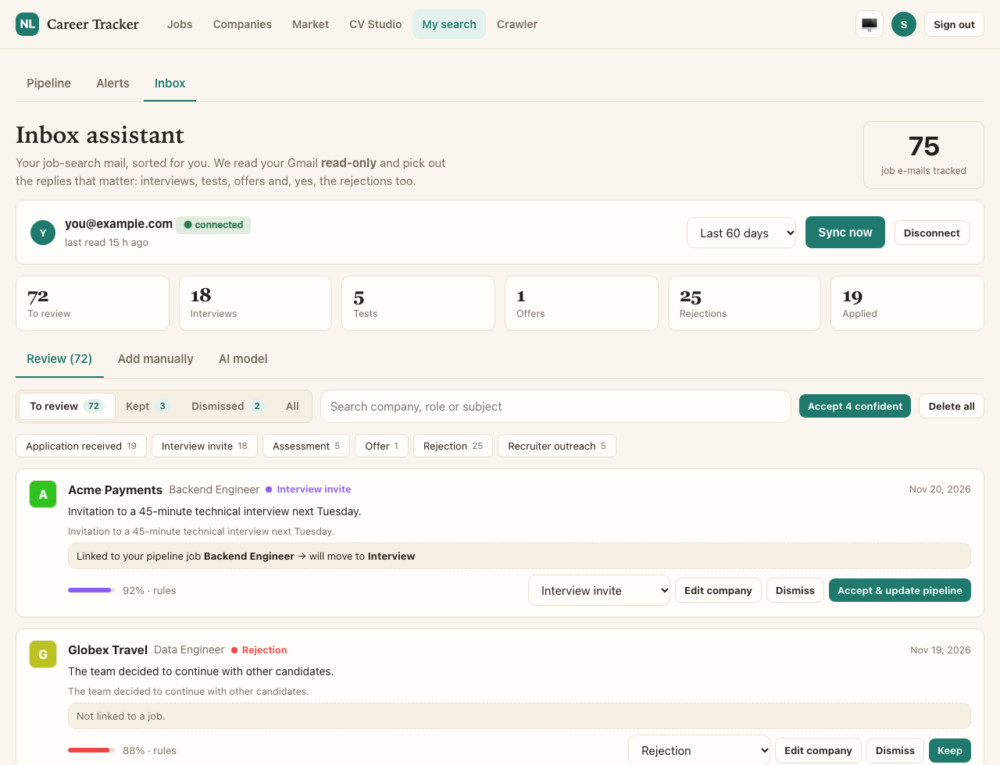
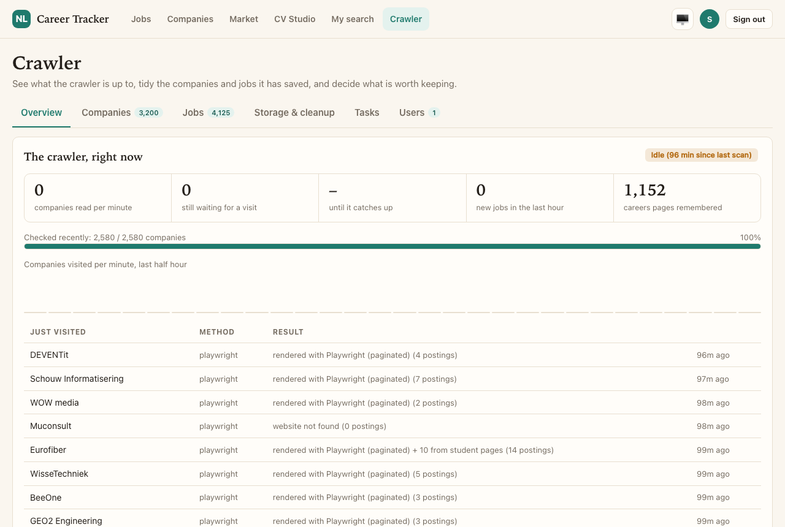
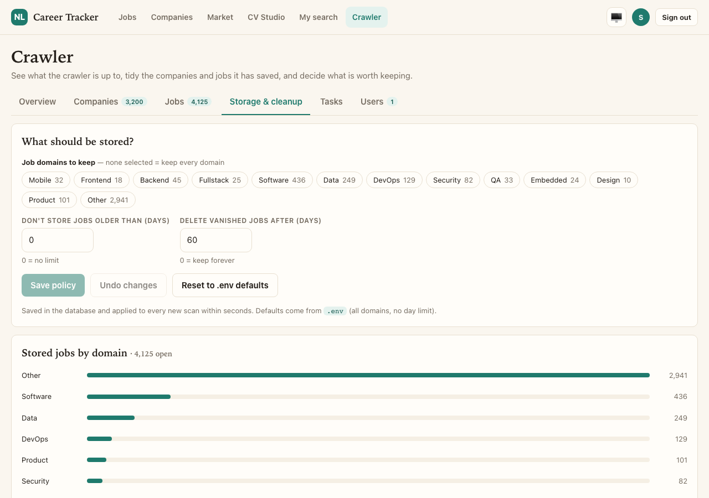
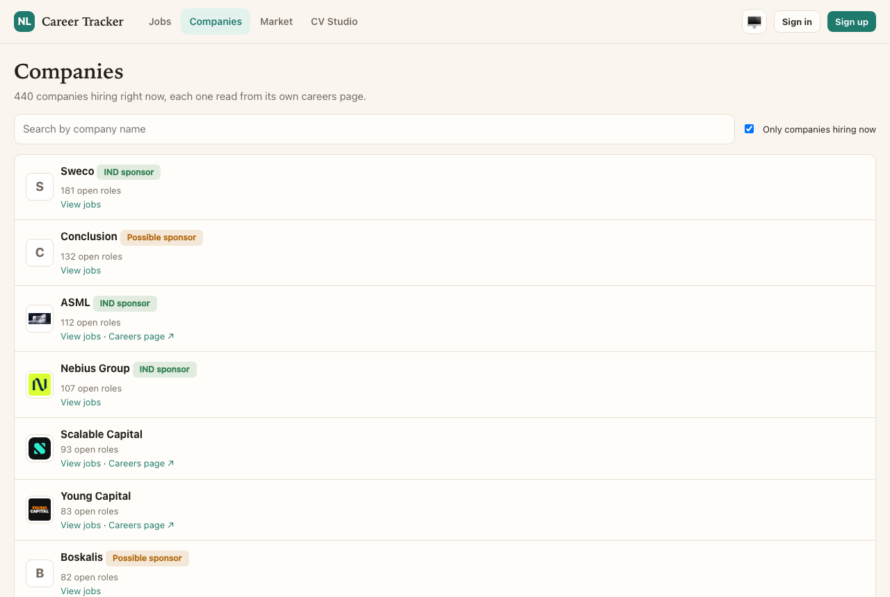
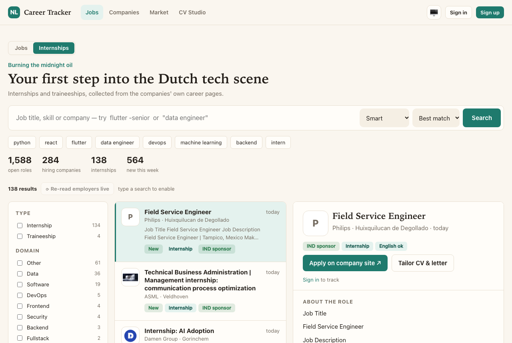
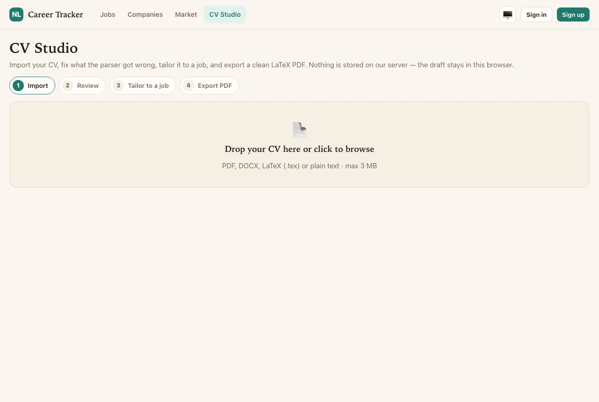
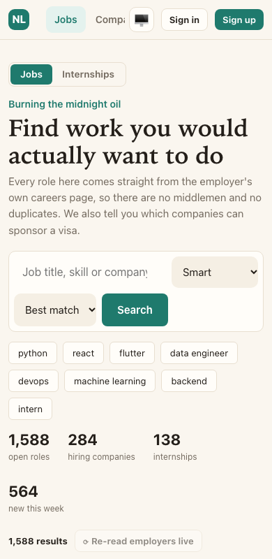
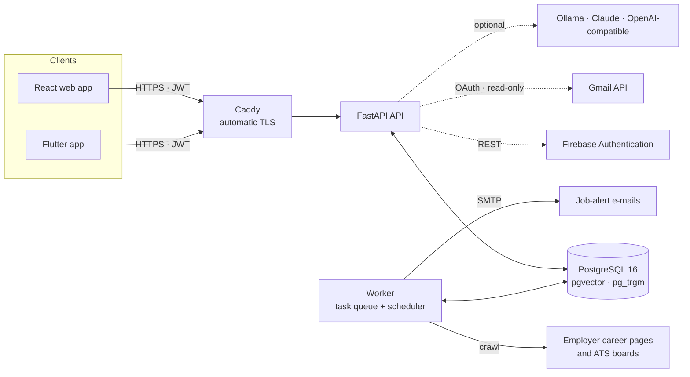

<div align="center">

# 🇳🇱 NL Career Tracker

### Find tech work in the Netherlands straight from the employers' own career pages, then keep your whole job search in one calm place.

*No aggregators. No duplicates. No stale listings. Your Gmail sorted into interviews, tests, offers and rejections.*

<br>


**[One-click setup](#-one-click-setup)** · **[Why use it](#-why-youll-like-it)** · **[Screenshots](#-see-it)** · **[Features](#-what-it-does)** · **[Tech stack](#-tech-stack)** · **[Architecture](#-architecture)** · **[Deploy](#-deploy-it-for-free)**

📱 The Flutter app lives in its own repo: **[nl-career-tracker-mobile](https://github.com/emelian-chkaira/nl-career-tracker-mobile)**

<br>


</div>

---

## ⚡ One-click setup

You need **Docker**. That is all: the script installs the rest, creates the tables and loads **ready-made data** (3,200 Dutch tech companies, 4,000+ open listings and the IND sponsor register), so the app is full the moment it opens.

```bash
git clone https://github.com/emelian-chkaira/nl-career-tracker.git
cd nl-career-tracker
./setup.sh
```

Then open **http://localhost:8787**, register (the first account becomes the admin) and start searching.

<details>
<summary><b>What <code>./setup.sh</code> does</b></summary>

1. Checks Docker, and Python 3.11+ / Node 18+. If those two are missing it simply runs everything in Docker instead.
2. Writes `.env` with a **fresh random secret** (never overwrites an existing one).
3. Starts **Postgres 16 + pgvector** in Docker.
4. Installs the backend, the headless browser and builds the website.
5. Creates the tables and **loads the starter data** (`backend/seed/`, about 470 KB, only into an empty database).
6. Starts the **crawler worker** in the background and the **API + website** in front.

Options: `--docker` (whole stack in containers, no Python or Node needed) · `--no-start` · `--no-browser`.
Safe to run again: it never overwrites your data or your `.env`.
</details>

> **About the starter data.** It is a snapshot made from a real crawl: company names, career-page links, city, visa-sponsor status and the title, location, link, domain and skills of open listings. It deliberately contains **no job descriptions**. As soon as the worker visits a careers page it replaces the snapshot with fresh, complete data, so it is a head start, not a database to rely on.

## 💚 Why you'll like it

| | For job seekers | For people who run it | For developers |
|---|---|---|---|
| **The point** | Every role comes from the company's own careers page, so nothing is stale, copied or behind a recruiter | Your own private copy, in one command, no cloud account | A real, readable full-stack codebase |
| **Saves you time** | Hybrid keyword + semantic search, filters by domain and visa sponsor, alerts for saved searches | The crawler keeps itself fresh; the Crawler page shows what it is doing | Typed everywhere, 90 backend tests against a real Postgres |
| **Netherlands-aware** | IND sponsor badge, salary vs the highly-skilled-migrant threshold, "English OK / Dutch required" | Choose what to store: only mobile jobs, only backend, only the last 30 days… | Clean boundaries: routers, services, crawler, CV tools, workers |
| **Keeps you organised** | Pipeline (saved → applied → interview → offer) and a **Gmail inbox that sorts replies for you** | Open source (MIT), self-hosted, your data stays on your machine | Web, mobile and API share one contract |
| **Respects you** | Read-only Gmail via Google sign-in, no password shared, e-mail text never stored | Polite crawler: robots.txt, rate limits, your own contact in the User-Agent | Secrets encrypted, SSRF guard, refresh-token rotation |

## ✨ See it

<table>
  <tr>
    <td width="50%"><br><sub><b>Inbox assistant</b>: Gmail sorted into interviews, tests, offers and rejections (sample data)</sub></td>
    <td width="50%"><br><sub><b>Crawler</b>: see what it is doing, manage companies and jobs</sub></td>
  </tr>
  <tr>
    <td width="50%"><br><sub><b>Choose what to store</b>: domains, age limits, one-click cleanup with previews</sub></td>
    <td width="50%"><br><sub><b>Market dashboard</b>: postings per day, cities, contract types, skills</sub></td>
  </tr>
  <tr>
    <td width="50%"><br><sub><b>Companies</b>: every employer with its IND sponsor badge</sub></td>
    <td width="50%"><br><sub><b>Internships &amp; traineeships</b>: one switch away from Jobs</sub></td>
  </tr>
  <tr>
    <td width="50%"><br><sub><b>Dark mode</b>: follows your system, or switch it yourself</sub></td>
    <td width="50%"><br><sub><b>CV Studio</b>: import, fix, tailor and export a clean LaTeX PDF</sub></td>
  </tr>
</table>

<p align="center"><br><sub>Fully responsive, and there is a native <a href="https://github.com/emelian-chkaira/nl-career-tracker-mobile">Flutter app</a> too.</sub></p>

> Screenshots use the author's development database (about 1,600 open roles). The Inbox screenshot uses made-up sample e-mails.

---

## 🎯 Why it exists

Job boards copy each other. The same vacancy shows up five times, weeks after it was filled, with the wrong salary and a broken apply link.
**NL Career Tracker goes to the source:** it discovers Dutch tech employers, finds their real career pages and ATS boards, reads the postings itself and keeps them fresh.
Then it adds what a job seeker in the Netherlands actually needs: **is this company an IND-recognised sponsor? is the salary above the highly-skilled-migrant threshold? is the role English-friendly?** — and a CV tool that tailors your CV to each posting.

## 🚀 What it does

| | |
|---|---|
| 🔎 **Search that understands you** | Full-text (ranked, highlighted), **semantic** (pgvector + a local embedding model) and **hybrid** (reciprocal-rank fusion). Operators: `"exact phrase"`, `-exclude`, `title:` `company:` `location:` `skill:`. Typo tolerant, with synonyms and a personal "fit" score. |
| 🏢 **Employer-direct crawler** | Public ATS APIs → career-page crawl (+ sitemap) → schema.org JSON-LD → headless Chromium. NL-only, de-duplicated, vanished postings marked expired, dead ends backed off exponentially. |
| 🎓 **Internships & traineeships** | Student and early-career pages are crawled and **classified** (internship / junior / senior / traineeship). |
| 🛂 **IND sponsor + salary check** | Each employer is matched against the IND list of recognised sponsors; stated salaries are compared with the IND thresholds. A **badge**, never a filter. |
| 📬 **Inbox assistant** | Connect Gmail (read-only Google sign-in). It finds **applications, interview invites, tests, offers and rejections**, extracts company and role, links them to your pipeline and lets you accept or dismiss each one. Choose the AI: built-in rules, local Ollama, Claude, or free Chinese models. |
| 🗂 **My search** | Pipeline (saved → applied → interview → offer), alerts and inbox in one place. |
| 🔔 **Job alerts** | Save any search → instant / daily / weekly, in-app and (optionally) by e-mail. |
| 🕷 **Crawler page** | Live worker status, full create/edit/delete for companies and jobs, CSV export, and an editable **storage policy** (keep only some domains, max age, one-click cleanup with previews). |
| 📊 **Market dashboard** | Open roles, hiring companies, postings per day, top cities and companies, contract types, 30-day skill demand, salary statistics. |
| 📄 **CV Studio** | Import **PDF, DOCX, text or LaTeX** keeping links and layout; fix the parse; tailor the CV to a job; export a **LaTeX PDF** that looks like your original; draft a cover letter. |
| 👤 **Accounts** | E-mail or **Google** sign-in (Firebase Authentication), e-mail verification, password reset. |
| 🌗 **Light & dark** | A plain, warm design system on web and mobile. |

---

## 🏗 Architecture



```
backend/   FastAPI · SQLAlchemy 2 · Alembic · Postgres 16
  app/core        config (CAREERS_* env), db, security, deps, rate limiting, secretbox (encryption), netguard (SSRF)
  app/models      ORM tables              app/schemas   request / response models
  app/services    business logic: auth, firebase, search, jobs, analytics, alerts, ingest, embeddings, task queue,
                  policy (what to store), maintenance, seed, gmail, mail classifier, llm providers
  app/api/v1      thin routers: auth, jobs, companies, me, analytics, cv, admin, mail, tasks
  app/crawler     discovery + ATS adapters + domain classifier + scoring (sponsor, salary, language, seniority)
  app/cvtools     PDF layout reader, CV parser, LaTeX generator / compiler, AI tailoring
  app/workers     separate process: DB-backed task queue (FOR UPDATE SKIP LOCKED) + scheduler
  seed/           ready-made starter data (companies, job snapshot, IND sponsors)
  migrations/     Alembic             tests/   pytest against a real Postgres
frontend/  React 18 · TypeScript · Vite — feature folders: auth, jobs, companies, dashboard, alerts, pipeline, inbox, cv, profile, admin (Crawler)
deploy/    production compose pieces: Caddyfile, server setup, update and backup scripts
docs/      FIREBASE.md · GMAIL_OAUTH.md · DEPLOY_ORACLE.md · screenshots
setup.sh   the one-click installer
```

The API is stateless and the worker coordinates through Postgres, so both scale horizontally. The in-process rate limiter is per instance: put a gateway or Redis limiter in front when running several API replicas.

## 🧰 Tech stack

| Layer | Technology | Why this choice |
|---|---|---|
| **API** | Python 3.13, **FastAPI**, Pydantic v2, SQLAlchemy 2, Alembic | Typed, fast to write, automatic API docs, real migrations |
| **Database** | **PostgreSQL 16** + **pgvector** + **pg_trgm** | One database for relational data, full-text, vector search and typo tolerance. No extra search server |
| **Search** | `tsvector`, `fastembed` (BAAI/bge-small-en-v1.5, local ONNX), reciprocal-rank fusion | Keyword + semantic + hybrid ranking with no API key and no per-query cost |
| **Crawling** | `httpx`, BeautifulSoup + lxml, **Playwright** (Chromium) | Fast for APIs and plain HTML, a real browser only when a site needs it |
| **Task queue** | Postgres `FOR UPDATE SKIP LOCKED` | Reliable background jobs without Redis or Celery |
| **Mail + AI** | **Gmail API** (OAuth, read-only), Ollama, Anthropic, OpenAI-compatible, Zhipu / Qwen / DeepSeek / Kimi | Your choice of model, from fully local and free to paid; keys encrypted at rest |
| **CV tools** | `pdfminer.six`, `pypdf`, **LaTeX** (tectonic), Anthropic API (opt-in) | Layout-aware PDF reading, LaTeX output, consent-gated AI tailoring |
| **Auth** | **Firebase Authentication** (REST), JWT, **argon2id**, rotating refresh tokens | E-mail + Google sign-in without running your own mail or identity system |
| **Web** | **React 18**, **TypeScript**, Vite, TanStack Query, Recharts | Strictly typed client, cached server state, small bundle |
| **Mobile** | **Flutter**, Cubit (flutter_bloc), Dio, get_it | One codebase for iOS and Android, same API as the web |
| **Infra** | **Docker** (multi-stage), Docker Compose, **Caddy** (auto-HTTPS), GitHub Actions | One-command local stack, production stack with HTTPS, CI per part |
| **Quality** | pytest on a real Postgres (90 tests), `tsc`, `flutter analyze` | Regression safety where it matters |

## 🏆 What this project achieves

**Data**
- 📥 Reads vacancies from **11 ATS platforms** (Greenhouse, Lever, Ashby, Recruitee, SmartRecruiters, Workable, Teamtailor, Personio, BambooHR, Homerun, Workday) and falls back to generic career-page crawling, JSON-LD and a headless browser when a company has no public API.
- 🧹 Merges duplicates (same title and location under different URLs), expires vanished postings, and backs off on dead ends.
- 🛂 Enriches every posting with sponsor status, salary-threshold comparison, language requirements and seniority.

**Search**
- 🧠 One query box with **keyword, semantic and hybrid ranking**, an operator syntax, typo tolerance, an ontology of synonyms and a personal "fit" score.

**CV pipeline** — the part that took the most care
- 📄 A layout-aware PDF reader that **round-trips a real CV**: it keeps hyperlinks (from PDF link annotations mapped onto character boxes), right-aligned dates and locations, bold titles, and section order, then regenerates the CV as **LaTeX in the original's style** and compiles it to PDF.
- 🤖 Optional, consent-gated **AI tailoring** that may only reword the summary, bullets and skill order — it can never invent employers, dates or skills, and it reports requirements your CV lacks as *gaps*.

**Engineering**
- 🔐 Production-grade auth: Firebase as identity provider, argon2id for legacy accounts with **lazy migration** on first sign-in, short-lived JWTs, **refresh-token rotation with reuse detection**, verified-email enforcement, timing-equalised login checks, no user enumeration on password reset, per-IP rate limiting.
- 🧪 **90 backend tests** against a real Postgres (including a fake Firebase), CI per part (path-filtered GitHub Actions), strict typing on the web client.
- 📦 Reproducible deployment: a multi-stage Docker image, a production compose file with automatic HTTPS, backup and update scripts and a step-by-step free-tier guide.

## ⚡ Manual setup (if you prefer to do it by hand)

```bash
docker compose up -d db                       # Postgres + pgvector on localhost:5433
cd backend
python3 -m venv .venv && .venv/bin/pip install -r requirements-dev.txt
.venv/bin/playwright install chromium         # JS-rendered career pages
cp ../.env.example ../.env                    # set CAREERS_JWT_SECRET
./run.sh api                                  # migrates, then http://localhost:8787  (API docs: /api/docs)
PYTHONPATH=. .venv/bin/python -m app.cli seed # optional: load the ready-made starter data
./run.sh worker                               # second terminal: crawling, alerts, embeddings
cd ../frontend && npm install && npm run dev  # http://localhost:5173 (proxies /api to :8787)
```

The first account you register becomes the admin (set `CAREERS_ADMIN_EMAILS` to name admins yourself, or `CAREERS_FIRST_USER_ADMIN=0` to turn that off). Every signed-in user can open the **Crawler** page by default; on a public site set `CAREERS_OPEN_CRAWLER=false`.
Without a Firebase key the app uses its built-in e-mail/password sign-in, so local development needs no cloud account.

**Tests:** `cd backend && python -m pytest tests -q` (needs the Postgres from `docker compose up -d db`).

## 🧑‍💻 Run it yourself (open source)

This project is **MIT licensed** — download it, run it on your own machine, change it, and use it. It is built to be self-hosted:

1. Follow the [Quick start](#-quick-start). You need Docker (for Postgres), Python 3.12+ and Node 20+; no cloud account.
2. Register in the web app (the first account is yours), open the **Crawler** page and start with the tasks *sponsors*, *discover* and *scan_all*. The worker keeps scanning in the background, and the page shows live progress.
3. Decide **what you want to store** (next section), so the database only contains the jobs you care about.

> ⚖️ **Please crawl politely.** The crawler reads only public employer career pages and official ATS job feeds, respects `robots.txt`, rate-limits per domain and identifies itself with `CAREERS_CONTACT` (set it to your own address). You are responsible for how you use it: follow each site's terms, do not republish full job descriptions, and remove a company if its owner asks. See [DATA_SOURCES.md](DATA_SOURCES.md).

## 📬 Inbox assistant (AI + your mailbox)

Open **Inbox** in the web app. It reads your job-search e-mail (read-only), finds **applications, interview invites, tests, offers and rejections**, extracts the company, role and dates, links them to your pipeline, and lets you **review, correct and accept** each one — accepting moves the job in your pipeline (applied → interview → offer / rejected, never backwards).

1. **Connect Gmail** with Google sign-in (read-only OAuth, no password shared; one-time setup in [docs/GMAIL_OAUTH.md](docs/GMAIL_OAUTH.md)), or paste an e-mail / upload `.eml` files for any other provider. While your Google project is in *Testing* mode only the test users you list can connect (up to 100) and the login expires after 7 days; opening it to everyone requires Google's app verification.
2. **Choose the AI** — your pick, per user:

| Choice | Notes |
|---|---|
| **Built-in rules** | Free, offline, nothing leaves your server (English / Dutch / German keywords) |
| **Ollama** | Run Qwen, DeepSeek, Llama… on your own computer: free and private |
| **GLM (Zhipu), Qwen (Alibaba), DeepSeek, Kimi (Moonshot)** | Chinese models over their OpenAI-compatible APIs; some have free tiers or free quota, others are very cheap |
| **OpenRouter** | One key, many models, including `:free` ones |
| **Claude (Anthropic)** | Bring your own key: Haiku 5.5 is enough for classification, Sonnet 5.5 for better writing |
| **OpenAI / any OpenAI-compatible endpoint** | vLLM, LM Studio, LiteLLM, a company gateway… |

Model names, prices and free tiers change, so every preset is an editable default. API keys and the Google refresh token are **encrypted** before they are stored and are never sent back to the browser. Only the extracted facts are saved (company, role, category, a one-line summary), **not the e-mail body**, and you can delete everything with one click. If the AI call fails, the built-in rules are used for that e-mail, and when an external AI is chosen the app asks for your consent before sending any text.

On a public server set `CAREERS_ALLOW_PRIVATE_HOSTS=false`, so users cannot point the AI connection at internal addresses.

## 🗂 Choose what to store

Not everyone wants every job. Tell the crawler what to keep, in `.env`:

| Variable | Effect |
|---|---|
| `CAREERS_KEEP_DOMAINS=mobile,backend` | Store only these kinds of jobs. Domains: `mobile`, `frontend`, `backend`, `fullstack`, `software`, `data`, `devops`, `security`, `qa`, `embedded`, `design`, `product`, `other`. Empty = keep everything. |
| `CAREERS_MAX_JOB_AGE_DAYS=30` | Don't store postings older than this, and delete stored ones that got older. `0` = no limit. |
| `CAREERS_DELETE_EXPIRED_AFTER_DAYS=60` | Delete jobs that disappeared from the employer's page after this many days (default 60, `0` = keep forever). |

Every job gets a **domain** (rule-based, from the title, then the description and skills), which is also a filter in the job search. Jobs that someone saved to a pipeline are never deleted by retention.

**Housekeeping** — from the **Crawler** page (admins) or the command line:

```bash
cd backend
.venv/bin/python -m app.cli stats              # what is stored, by domain
.venv/bin/python -m app.cli backfill-domains   # classify jobs that have no domain yet
.venv/bin/python -m app.cli prune              # apply the current policy to jobs already stored
.venv/bin/python -m app.cli purge              # delete too-old / long-expired jobs (the worker also does this daily)
.venv/bin/python -m app.cli clear-jobs         # delete ALL jobs   (asks to confirm, or --yes)
.venv/bin/python -m app.cli clear-all          # delete ALL jobs and companies
```

On a **public** deployment set `CAREERS_OPEN_CRAWLER=false`, so only admins can run crawler tasks (the default `true` lets any signed-in user use the Crawler page, which is right for your own copy).

## 🌍 Deploy it for free

| Guide | What you get |
|---|---|
| **[docs/DEPLOY_ORACLE.md](docs/DEPLOY_ORACLE.md)** | Oracle Cloud *Always Free* VM + free DuckDNS domain + Caddy HTTPS + production compose, backups and updates |
| **[docs/FIREBASE.md](docs/FIREBASE.md)** | Firebase project, e-mail + **Continue with Google** on web and mobile, authorized domains, e-mail templates |

```bash
cp deploy/env.production.example .env          # DOMAIN, POSTGRES_PASSWORD, CAREERS_JWT_SECRET, Firebase keys …
docker compose -f docker-compose.prod.yml up -d --build
```

Read [DATA_SOURCES.md](DATA_SOURCES.md) first (licences, attribution, crawler etiquette) and set `CAREERS_CONTACT` so site owners can reach you.
Set `CAREERS_ALLOW_REGISTRATION=0` for a private instance.

## 🔧 Configuration

Everything is an environment variable — see [.env.example](.env.example) and `backend/app/core/config.py`.

| Variable | Purpose |
|---|---|
| `DATABASE_URL`, `CAREERS_JWT_SECRET`, `CAREERS_ADMIN_EMAILS` | Core settings (the JWT secret is mandatory in production) |
| `CAREERS_FIREBASE_API_KEY`, `CAREERS_GOOGLE_CLIENT_ID` | Turn on Firebase sign-in and the Google button |
| `CAREERS_REQUIRE_VERIFIED_EMAIL` | Refuse sign-in until the e-mail is confirmed |
| `CAREERS_SMTP_*`, `CAREERS_MAIL_FROM` | Job-alert e-mails (any SMTP relay) |
| `CAREERS_KEEP_DOMAINS`, `CAREERS_MAX_JOB_AGE_DAYS`, `CAREERS_DELETE_EXPIRED_AFTER_DAYS` | What the crawler stores and how long it keeps it |
| `CAREERS_ALLOW_PRIVATE_HOSTS` | `true` (default): the Inbox may use localhost/LAN endpoints such as Ollama; `false` on a public server |
| `CAREERS_OPEN_CRAWLER` | `true`: any signed-in user can use the Crawler page; `false`: admins only |
| `ANTHROPIC_API_KEY` | Optional AI CV tailoring |

## 🕷 How a company is scanned

1. Known ATS board, else slug-guess the public APIs. Empty boards are ignored (often another company with the same slug).
2. Resolve the website, find the careers page (nav/footer links → common paths → `werkenbij.` / `careers.` subdomains → sitemap), detect more ATS vendors from it.
3. schema.org `JobPosting` JSON-LD → generic job links → headless Chromium (XHR interception, pagination, "load more").
4. De-duplicate, expire vanished postings, back off on dead ends.

## 🚧 Status

Built and tested locally. Be aware of what is **prepared but not yet exercised in production**:
- Firebase e-mail/password sign-up, sign-in and password reset, and the web **Continue with Google** button, have been run against a live Firebase project. The mobile Google button is still untested against a live client.
- The production Docker image builds and the full production stack (Caddy HTTPS, API, worker, Postgres) was smoke-tested locally; the first public deployment (Oracle) is still to do.
- AI CV tailoring is covered by mocked tests only.

## 📚 More

[PLAN.md](PLAN.md) — design notes · [DATA_SOURCES.md](DATA_SOURCES.md) — data licences & etiquette · [CONTRIBUTING.md](CONTRIBUTING.md) · MIT licensed.
Inspired by [career-ops](https://github.com/career-ops-hq/career-ops).
